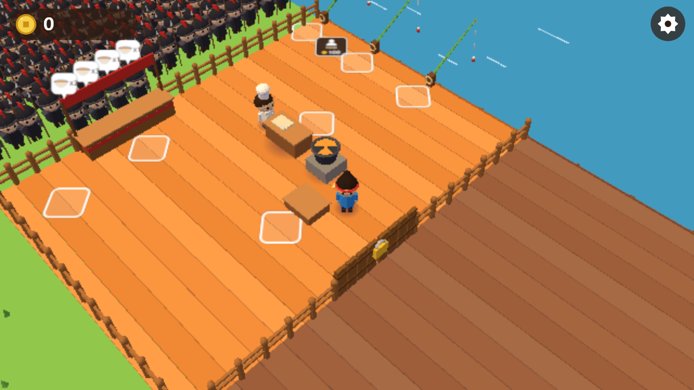

# Fishing Camp

**Run a riverside army camp's kitchen on your own: catch fish, cook soup, feed an endless crowd
of soldiers, then hire your way out of every job until the camp runs itself.**

An arcade idle game in the browser. You only move; every action happens when you stand on a tile.

### [▶ Play it in your browser](https://khanhnguyendev.github.io/fishing-camp/)



> **Status:** early development: a playable slice (zones 1 and 2), grown from a prototype into a
> TypeScript web project. Numbers come from the design document and are still being tuned.

## How to play

| Input | Does |
|---|---|
| WASD or arrow keys | Move |
| Drag anywhere (mouse or touch) | Floating joystick |
| Stand on a tile | Fish, drop off, pick up, collect cash or pay for an unlock |
| P or the gear button | Pause (R in the pause screen erases the save) |
| M | Mute |

**The loop:** catch a tuna at a bamboo rod → carry it to the chef's board → the pot makes 4 bowls
of soup → carry the bowls to the counter → soldiers eat and pay → collect the cash → stand on a
price tile to pay for the next unlock.

**The goal of this slice:** buy your way through zone 1, open the gate to the grill yard and sell
your first sushi plate. Play continues after that.

### Unlocks

| Unlock | Price | What it does |
|---|---:|---|
| Fisher 1, 2, 3 | 100 each | A fisher works that rod and carries fish to the chef |
| Bigger back | 150 | Carry more fish and dishes |
| Conveyor | 200 | Bowls ride from the kitchen to the counter on their own |
| Swift feet | 250 | Run faster |
| Gate to the grill yard | 500 | Opens zone 2: a grill, sushi and gold-armored soldiers who pay 3× |
| Second pot | 500 | Two fish cook at once; a pot-boy stirs the new pot |
| Yard fisher | 600 | A fisher for the grill yard's rod |

Every 3–5 minutes a **golden school** arrives: for 20 seconds every fish is gold and its dishes
sell for 5×. Progress saves after every unlock, and the camp earns while you are away
(up to 2 hours, once the conveyor runs).

## Run it locally

Needs Node.js 22.12 or later.

```bash
npm ci          # install the exact tool versions from package-lock.json
npm run dev     # play it at the address it prints, with live reload
```

Add `?fresh=1` to the address to start without the saved camp. On the dev server, press
`` ` `` (backquote) or add `?tune` for a panel of live sliders over every tuning value.

| Command | Does |
|---|---|
| `npm run dev` | Dev server with live reload and the tuning panel |
| `npm run build` | Type-checks and builds the shippable game into `dist/` |
| `npm test` | Unit tests (Vitest), then browser tests (Playwright) on the built game |
| `npm run smoke` | Just the boot test: the game opens to its title with no errors |

## Tuning

Every gameplay number (catch and cook times, prices, carry sizes, speeds, golden school timing,
camera) lives in [`data/config.json`](data/config.json), each with a min, max and step; what each
one means is in [`data/config-notes.md`](data/config-notes.md). Change a value and the dev server
reloads.

## What's in this repository

| Path | What it is |
|---|---|
| [`design/GDD.md`](design/GDD.md) | The full design: loop, systems, economy, zones, feedback, art |
| [`design/game-brief.md`](design/game-brief.md) | The one-page brief the game follows, with what is in and out of scope |
| [`src/`](src/) | The game in TypeScript: `game/` holds the rules (no browser code), `main.ts` the scenes, camp and loop, plus `screen.ts`, `audio.ts`, `config.ts` |
| [`data/`](data/) | Tuning values and their notes |
| [`tests/`](tests/) | `unit/` rules under Vitest, `integration/` boot and same-seed replay under Playwright |
| [`public/`](public/) | The home-screen manifest and icon |
| [`prototypes/fishing-camp/`](prototypes/fishing-camp/) | The original one-file prototype the game grew from, kept as it was, with its build evidence |
| [`.github/workflows/pages.yml`](.github/workflows/pages.yml) | Tests, builds and deploys the game to GitHub Pages |
| `.claude/`, `docs/`, `studio-tests/`, `CLAUDE.md` | The Claude Code Game Studios workflow the game is built with |

## Deploying

Pushing to `main` with a change to the game (`src/`, `data/`, `public/`, `index.html`, the
package or build config) runs the Pages workflow: it installs, runs the unit tests, builds
`dist/` and publishes it to <https://khanhnguyendev.github.io/fishing-camp/>. A failing test stops
the deploy.

## What's next

Out of scope for this slice, planned for later: zones 3–4 (rice field, great hearth), the
general's visit and blizzard events, music, new maps with permanent progress, and long-session
balance. Ads and in-app purchases are not in this build.

## Credits

- Built with [Claude Code Game Studios](https://github.com/Donchitos/Claude-Code-Game-Studios),
  a Claude Code workflow for designing and building games (MIT License, © 2026 Donchitos; see
  [`LICENSE`](LICENSE)). Its own documentation is in [`docs/`](docs/) and
  [`UPGRADING.md`](UPGRADING.md).
- 3D rendering by [three.js](https://threejs.org) (MIT).
- All art is drawn in code from simple shapes; sounds are synthesized in the browser.
